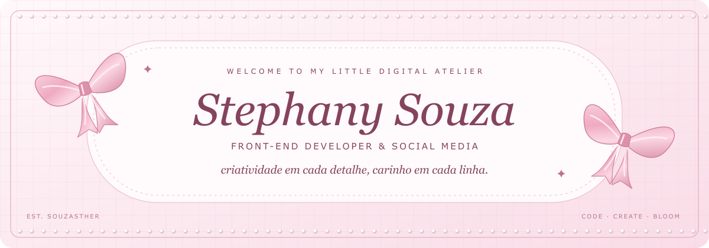
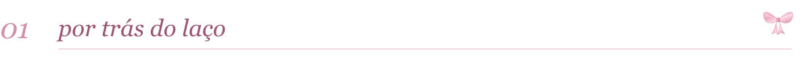
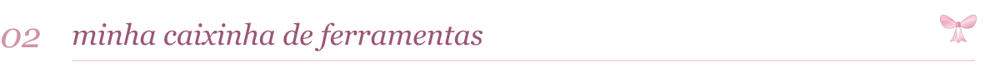
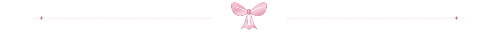
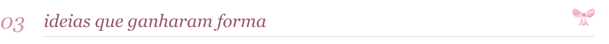
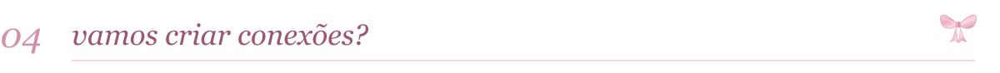
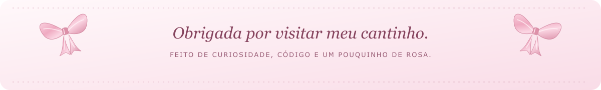

<!-- Identidade visual original para SouzaSther. Os arquivos em assets fazem parte deste README. -->

  

<b>🎀 Design que encanta. Código que dá vida.</b> Meu cantinho para transformar ideias em experiências digitais.

  
  
  

Olá! Eu sou a **Stephany Souza**, desenvolvedora front-end e social media. Gosto de unir **design, tecnologia e criatividade** para criar interfaces modernas e responsivas e dar vida a conteúdos e experiências digitais.

🎓 Estudo **Análise e Desenvolvimento de Sistemas**.  
🌱 Estou aprofundando meus conhecimentos em **JavaScript, Vue.js e React**.  
🌷 Construo meus projetos com carinho, curiosidade e dedicação.  
✨ Meu sonho é me tornar uma desenvolvedora incrível e inspiradora.

<i>“Entre ideias, cores e linhas de código, vou construindo a minha própria história.”</i>

<b>Na minha bancada criativa</b>

  
  
  
  
  
  

<b>Florescendo nos estudos</b>

  
  
  

Aprender → experimentar → construir → evoluir ♡

<table>
  <tr>
    <td width="50%" valign="top">
      <h3>💍 Aurora Joias</h3>
      
Uma vitrine de joias com catálogo, carrinho e checkout simulado.

      
<code>Vue</code> <code>Pinia</code> <code>Bootstrap</code>

      <a href="https://github.com/SouzaSther/LOJA-DE-JOIAS-SISTEMA">Abrir projeto ↗</a>
    </td>
    <td width="50%" valign="top">
      <h3>🌷 Landing page minimalista</h3>
      
Uma página delicada e responsiva para apresentar serviços.

      
<code>React</code> <code>TypeScript</code>

      <a href="https://github.com/SouzaSther/LandingPage-minimalista">Abrir projeto ↗</a>
    </td>
  </tr>
  <tr>
    <td width="50%" valign="top">
      <h3>🎀 Hair salon website</h3>
      
Um espaço na web para um salão de beleza.

      
<code>HTML</code>

      <a href="https://github.com/SouzaSther/Hair-salon-website">Abrir projeto ↗</a>
    </td>
    <td width="50%" valign="top">
      <h3>🛍️ Site de vendas</h3>
      
Um modelo de vitrine digital para apresentar produtos.

      
<code>React</code> <code>TypeScript</code>

      <a href="https://github.com/SouzaSther/Site-Vendas-Modelo">Abrir projeto ↗</a>
    </td>
  </tr>
</table>

<a href="https://github.com/SouzaSther?tab=repositories">♡ Explore os meus outros projetos</a>

Tem uma ideia bonita para tirar do papel? <b>Vou adorar conhecer você e conversar sobre novos projetos.</b>

  
  
  

